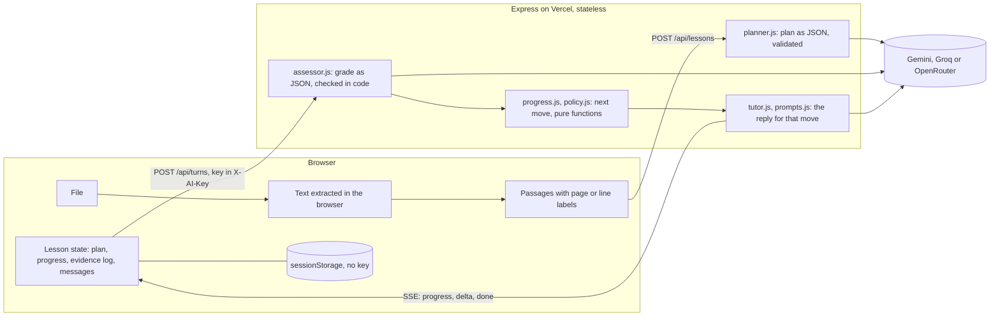

# Teach Me This File

A teacher uploads a file and writes a short prompt ("Teach this to 7th graders, in French. Be Socratic. Keep it under 15 minutes."). The app turns the file into a lesson plan and opens a chat in which an AI tutor teaches it to a student one step at a time: it explains one idea, waits for the student, asks a question about it in a separate message, grades the answer, gives hints before answers, and moves on when the student has shown the idea.

I built it as the home assignment for an AI Engineer role. The reasoning behind the main choices, what I left out, the known weaknesses and how I tested it are in [DECISIONS.md](DECISIONS.md).

- Live app: https://teach-me-this-file.vercel.app
- Stack: React 19, Vite, Tailwind CSS 4 and JavaScript in the browser; Node.js and Express 5 on the server; deployed on Vercel.
- AI: bring your own key (Google AI Studio, Groq or OpenRouter). The live site also has a limited demo key on the server.

## Using it

1. **Key.** Click the key button at the top right ("Demo key · use yours" on the live site) and paste your key. It is kept in the tab's memory only.
2. **Material.** Drop a PDF with selectable text, a Word `.docx`, or a `.txt` / `.md` file, or pick one of the two samples (English and Hebrew). The file card says what was read: pages, passages, direction, and anything that was skipped.
3. **Instructions.** Write the teacher prompt: audience, style, length, goals. The lesson language follows the prompt, or you can choose it.
4. **Lesson.** The tutor explains one idea and asks whether it makes sense. Reply, and the check question comes in its own message. Answer it, ask a question, or use "Hint" and "Explain differently". Press Stop or Esc to stop a reply.
5. **Progress and sources.** The header shows "Step x of y" and the plan panel shows each step's state and what it rests on ("after a hint", "shown on your own"). Each tutor message links the passages it used; click one to read the passage.
6. **End.** A short final check (no hints) on the weakest steps, then a summary that says only what the student showed, with an optional practice round.

A reload restores the lesson in the same tab. The key is not kept, so paste it again.

## How it works



- **UI** (`src/components`) shows the lesson and sends the student's input. It holds no lesson logic.
- **Lesson state** lives in the browser (`src/lesson/chatReducer.js`): the plan, the progress of every step, and an evidence log of every graded answer. It is sent with each turn and validated by the server (`server/validation.js`). The server keeps nothing between requests, which suits serverless hosting.
- **Lesson engine** (`server/lesson/progress.js`, `policy.js`): pure functions that take the progress and a grade and return the next move ("hint", "advance", "check an earlier step", ...) with a reason code. The model never decides what happens next.
- **The model** has three narrow jobs: write the plan as JSON, grade one answer as JSON, and write the message for a move the code already chose. Each grade is checked in code before it is used (`server/lesson/assessor.js`).
- **Learner state** (`shared/learner.js`): one function derives each step's state (not checked, developing, shown on your own, worth another look) from the evidence log. A right answer counts as shown on your own only if no hint, smaller question or earlier explanation gave it.
- **Sources**: the file is split into passages that keep their page or line label. The tutor may cite only passages it was given; the server drops other ids and checks quotes against the file (`shared/citations.js`).
- **Providers** (`server/providers`): Gemini with fallback models and cooldowns, and an OpenAI-compatible client for Groq and OpenRouter. Streaming is SSE over a POST. Stop aborts the request, and the server aborts the provider call.

## Files: what works and what does not

| Input | Behaviour |
| --- | --- |
| PDF with selectable text | Read with pdf.js, with page labels. Running headers and footers are removed; headings are detected from font size. Up to 300 pages. |
| Word `.docx` | Read with mammoth. Headings and tables (as rows) are kept. |
| `.txt`, `.md` | UTF-8, UTF-16 or Windows-1255 Hebrew; Markdown headings become sections. |
| Hebrew, Arabic and other right-to-left text | Detected; passages and messages render right to left. |
| Scanned PDF (no text layer) | Refused with a clear message: no OCR. Pages without text in a mixed PDF are skipped and listed. |
| Formulas | Read as plain text from the file; the tutor's replies render LaTeX math with KaTeX. Formulas in PDFs can come out out of order. |
| Long files | Up to 25 MB and 600,000 characters. Above 60,000 characters the plan is built from passages sampled across the file, and the file card says so. Every passage can still be cited. |
| Empty, damaged, password-protected, renamed or unsupported files (`.pptx`, `.doc`, images) | A specific message and no lesson. |

## Run it locally

Requirements: Node.js 20.12 or newer.

```bash
npm install
cp .env.example .env    # optional
npm run dev             # API on :8787, Vite on :5173 (proxies /api)
```

Open http://localhost:5173 and paste a key in the settings. Free keys: https://aistudio.google.com/apikey (Gemini), https://console.groq.com/keys, https://openrouter.ai/keys.

Without any key, `npm run demo` builds the app and serves it on http://localhost:4400 with scripted replies and a banner that says no model is used. It shows the flow, not the teaching.

## Configuration

The key typed in the settings is sent in the `X-AI-Key` header with each request, passed to the provider and never stored or logged. Optionally the server has its own key; a typed key always wins. The server key only answers same-origin requests and has a daily budget, which is a brake on casual use, not access control.

| Variable | Default | Purpose |
| --- | --- | --- |
| `AI_API_KEY` | empty | Optional server key (`GEMINI_API_KEY` also works) |
| `AI_PROVIDER` | detected from the key | `gemini`, `groq` or `openrouter` for the server key |
| `SERVER_KEY_DAILY_LIMIT` | `400` | Requests per day for the server key, per server instance |
| `GEMINI_MODELS` | `gemini-3.6-flash,gemini-3.8-flash,gemini-2.5-flash` | Gemini models, tried in order when one is busy, slow or out of quota |
| `GEMINI_BACKUP_MODELS` | `gemini-3.5-flash-lite` | Used only after the main ones fail; the UI says when |
| `GROQ_MODEL` | `llama-3.3-70b-versatile` | Model for Groq keys |
| `OPENROUTER_MODEL` | `meta-llama/llama-3.3-70b-instruct:free` | Model for OpenRouter keys |
| `PROVIDER_TIMEOUT_MS`, `PROVIDER_DEADLINE_MS` | `15000`, `40000` | One model call, and one turn across all models |
| `PLAN_TIMEOUT_MS`, `PLAN_DEADLINE_MS` | `35000`, `75000` | The same for planning |
| `RATE_LIMIT_PER_MINUTE` | `30` | Per IP, on the AI endpoints |
| `PORT` | `8787` | Local API port |
| `ALLOW_MOCK_PROVIDER` | `false` | Adds a mock provider to the settings, for local testing |

Deploying: import the repository in Vercel. `vercel.json` builds the front end to `dist/`, and `api/index.js` serves every `/api/*` route as one function. Any Node host also works: `npm run build`, then `npm start` behind the same origin.

## Tests

```bash
npm test             # Vitest: lesson engine, learner state, grading checks, prompts, file reading, citations, API with a mock model, storage, translations
npm run lint
npm run test:e2e     # builds, then drives the app in Chromium with the mock model: 15 screen sizes, English and Hebrew, axe-core, a full lesson, stop, provider failure and retry, reloads
npm run eval:teaching   # the lesson engine on 49 labelled scenarios (dev and held-out), no model calls
```

Model-dependent behaviour was checked with real model calls; how, and the results, are in [DECISIONS.md](DECISIONS.md#how-i-know-it-works). The scenarios, runners and saved results are in [`eval/`](eval/README.md). `eval/live-lesson.mjs` drives the real interface in a headless browser (a local build or a deployed URL) while a person answers each message.

## Project layout

```
src/            React app: components, lesson state (chatReducer, useTutor), file reading (document/), i18n (English, Hebrew, French)
server/         Express app: routes, validation, errors, rate limit, server-key budget
server/lesson/  planner, assessor, progress (state machine), policy, prompts, tutor (one turn)
server/providers/  Gemini, OpenAI-compatible (Groq, OpenRouter), mock
shared/         code used by both sides: learner state, citations, text and BM25 ranking
api/index.js    Vercel entry
tests/          unit, property and API tests; tests/e2e/ui.mjs is the browser harness
eval/           evaluation scenarios, runners and saved results
```

## Known limitations

- No OCR: scanned pages are detected and refused or skipped, not read.
- Formulas and tables in PDFs come out as plain text, sometimes out of order.
- Each step takes one more turn than a single teach-and-ask message, and one more model call. On the free tier this uses the daily quota faster, and slow model replies hit the 15-second timeout (see DECISIONS).
- The lesson lives in one browser tab; closing it ends the lesson.
- Rate limits, the server-key budget and model cooldowns are in memory per server instance.
- The tutor's teaching was tested with scripted students and my own answers, mostly on Gemini models. No study with real students has been run.
